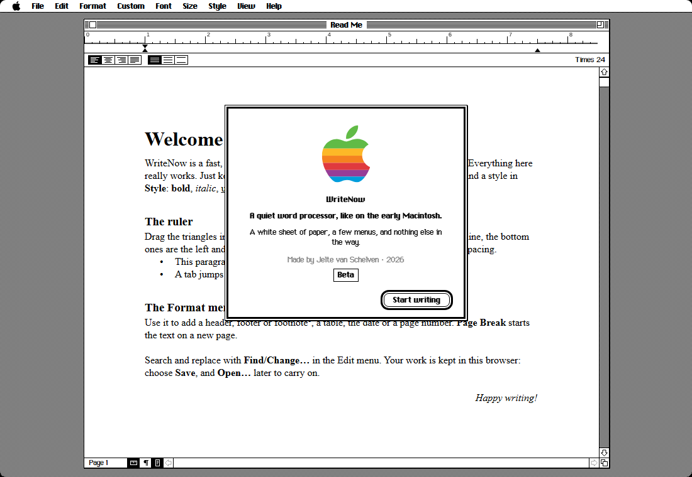

# WriteNow

**A quiet word processor in the style of the classic Macintosh — a desktop program for Windows, macOS and Linux.**



WriteNow is a tribute to the fast, simple word processors of the early Mac era: a white sheet of paper, a menu bar, a ruler, and nothing else in the way. No accounts, no cloud, no ads. It is small, starts instantly, and everything you write stays on your own computer.

> **Beta** · Made by Jelte van Schelven · Independent tribute, not affiliated with T/Maker or Apple ([details](NOTICE.md))

---

## Download

| | Download | Then |
|---|---|---|
| 🪟 **Windows 10 / 11** | [WriteNow-for-Windows.zip](https://github.com/jeltevanschelven8-afk/writenow/raw/main/dist/WriteNow-for-Windows.zip) | unzip, right-click `install.ps1` › **Run with PowerShell** |
| 🍎 **macOS 11 or newer** | [WriteNow-for-Mac.zip](https://github.com/jeltevanschelven8-afk/writenow/raw/main/dist/WriteNow-for-Mac.zip) | unzip, run `make-app.command` once in Terminal |
| 🐧 **Linux** | [WriteNow-for-Linux.zip](https://github.com/jeltevanschelven8-afk/writenow/raw/main/dist/WriteNow-for-Linux.zip) | unzip, run `bash install.sh` |

After installing, start WriteNow from the Start menu, the Applications folder or your app menu. Step-by-step instructions, updating, uninstalling and troubleshooting are in the **[installation guide](docs/INSTALL.md)**.

---

## What it can do

**Writing and layout**
- Fonts from the original Mac, rebuilt pixel by pixel: Chicago, Geneva, Monaco, New York, Athens, London, Los Angeles, San Francisco and Venice, plus Courier, Helvetica, Palatino and Times
- Sizes from 9 to 72 point, bold, italic, underline, outline, shadow, strikethrough, superscript and subscript
- A real ruler: drag the triangles to set first-line, left and right indents; buttons for alignment and line spacing
- Paragraph styles (title, subhead, body text, quotation), copy and apply ruler settings

**Documents**
- Headers, footers and automatically numbered footnotes
- Tables, page numbers, date and time, horizontal lines and page breaks
- Find and Change with whole-word and match-case options, undo and redo, word count

**Files**
- Save and open documents inside WriteNow
- Import plain text, HTML and **PDF** — the text of a PDF becomes an editable document
- Appears under **Open with** for PDF files on Windows, macOS and Linux

**Look and feel**
- Black-and-white 1984 look, or the grey "Platinum" look of Mac OS 8 and 9 (View menu)
- Its own window with classic title bar and scroll bars, show invisibles, fit page to window
- Works offline

---

## How it runs on each system

| | Program | Your documents |
|---|---|---|
| Windows | its own window, opened through Microsoft Edge (part of Windows) without address bar or tabs | inside WriteNow's own profile in `%LOCALAPPDATA%\Programs\WriteNow` |
| macOS | a native app (Swift + WebKit), built once on your own Mac | inside the app's storage |
| Linux | its own window, opened through Chrome, Chromium, Edge, Brave or Vivaldi | inside WriteNow's own profile in `~/.local/share/writenow` |

WriteNow only starts as an installed program; opening its files directly in a web browser shows a short note on how to install it. Nothing is uploaded anywhere. The only network requests are Google Fonts for Courier, Helvetica and Times, and the PDF reader ([pdf.js](https://mozilla.github.io/pdf.js/)), which loads the first time you open a PDF.

---

## For developers

```
writenow.html    the whole program: the source of everything
build.py         builds the three packages from writenow.html
windows/         install.ps1, uninstall.ps1, icon
mac/             main.swift (native wrapper), make-app.command, icon
linux/           install.sh, uninstall.sh, icon
tests/           stress tests
docs/            installation guide and screenshot
dist/            ready-made downloads (output of build.py)
```

**Build** (Python 3, no packages needed):

```
python build.py
```

This refreshes `index.html` in `windows/`, `mac/` and `linux/` and writes the downloads to `dist/`. Edit `writenow.html`, never the generated `index.html` files.

**Test:** run `python -m http.server 8794` in the repository and open <http://localhost:8794/tests/stress.html> in Chrome or Edge. 47 tests attack the real program: hostile imports and pastes, odd file names, search edge cases, documents of 30 000 paragraphs, full or broken storage, corrupted saved data, damaged PDFs and thousands of random key presses. The summary should read `47 / 47 passed`.

---

## Status and known limitations

WriteNow is in beta. It has been tested on Windows.

- The macOS app has not yet been built and tested on a real Mac, and the Linux installer has not been tested on a real Linux desktop. If something fails, please [open an issue](https://github.com/jeltevanschelven8-afk/writenow/issues) with the error message.
- There is no printing and no column layout (the menu items are shown disabled, as in the original).
- Pages are shown as dotted lines; long text flows across them, and only a page break moves text to the next page.
- PDF import keeps text, headings and page breaks, not images or the exact layout, and cannot read scanned PDFs.

Bug reports and pull requests are welcome. Please run the stress tests before sending a change.

---

## Credits

Created by **Jelte van Schelven**, 2026. Inspired by the original WriteNow for the Macintosh (1986).
PDF support by [pdf.js](https://github.com/mozilla/pdf.js) (Apache License 2.0).
See [NOTICE.md](NOTICE.md) for trademarks and licensing.
